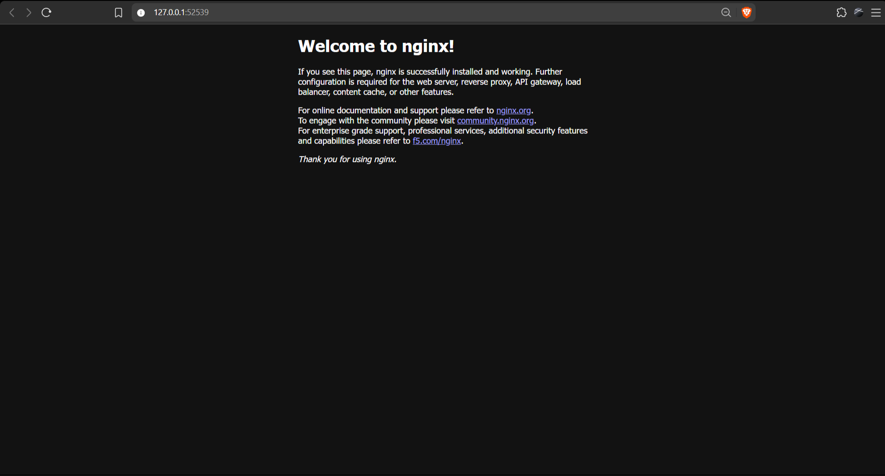

# Exercise 1: Hello Pod

## Problem Statement

As a DevOps Engineer at Zepto, deploy the product team's lightweight web app (storefront and delivery status page) on Kubernetes so that it is always running, portable, and can be scaled later. The app is simulated using the `nginx` container image.

**Goal:** Run the first app inside Kubernetes as a Pod, expose it as a Service, and access it in the browser.

**Environment:** Windows, VS Code integrated terminal (Command Prompt), Minikube

---

## Solution (Brief)

1. Start a local single-node Kubernetes cluster using Minikube.
2. Create a Pod named `hello-k8s` running the `nginx` image on port 80.
3. Verify that the Pod is in the `Running` state.
4. Expose the Pod as a `NodePort` Service so it is reachable from outside the cluster.
5. Open the Service in the browser using Minikube and confirm the Nginx welcome page loads.

---

## Commands Executed

### Step 1: Start the Minikube cluster

```cmd
minikube start
```

### Step 2: Create the Pod using the Nginx image

```cmd
kubectl run hello-k8s --image=nginx --port=80
```

### Step 3: Verify the Pod is running

```cmd
kubectl get pods
```

### Step 4: Expose the Pod as a Service

```cmd
kubectl expose pod hello-k8s --type=NodePort --port=80
```

### Step 5: Open the app in the browser

```cmd
minikube service hello-k8s
```

---

## Output / Proof

Nginx welcome page opened in the browser after running `minikube service hello-k8s`:



---

## Result

The `hello-k8s` Pod is running the Nginx image inside the Minikube cluster, exposed through a NodePort Service, and the Nginx welcome page loads in the browser.