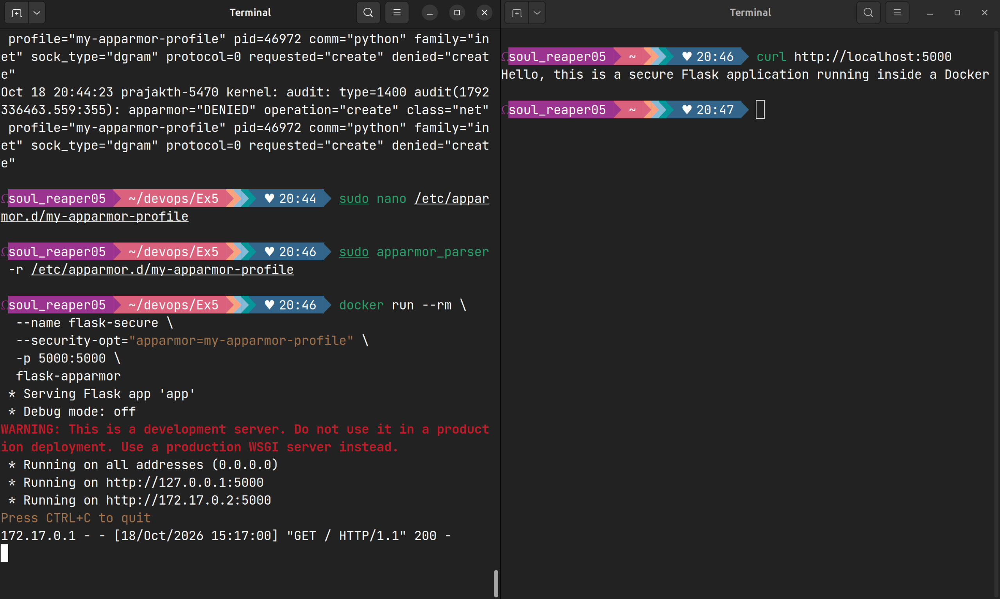
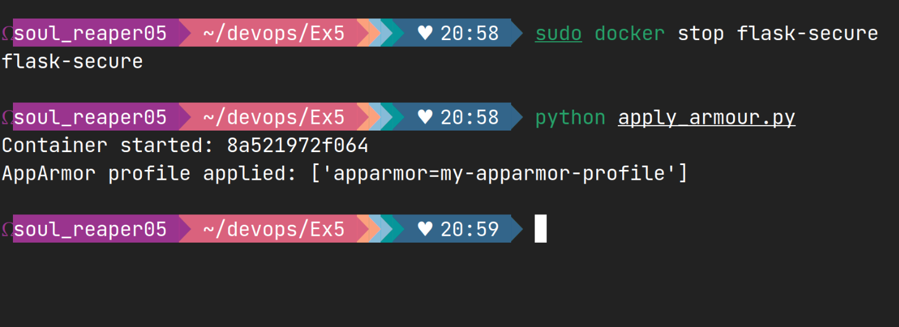
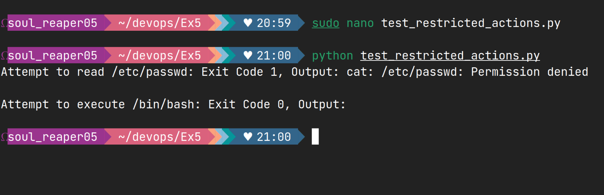

# Docker Security with AppArmor and Python

## Overview

This project demonstrates container security using Docker, Python, Flask, and AppArmor. A custom AppArmor profile is applied to a Docker container to restrict filesystem access, network operations, and Linux capabilities while allowing the Flask application to run.

## Technologies Used

- Python
- Flask
- Docker
- AppArmor
- Docker Python SDK

## Project Structure

```text
Ex5/
├── app.py
├── Dockerfile
├── my-apparmor-profile
├── apply_armour.py
└── README.md
```

## Prerequisites

- Linux system with Docker installed
- AppArmor enabled on the host
- Python 3 and pip

Verify the installation:

```bash
docker --version
sudo aa-status
```

## Setup and Installation

### 1. Build the Docker Image

Navigate to the project directory and build the image:

```bash
docker build -t flask-apparmor .
```

### 2. Load the AppArmor Profile

Copy the custom profile into the AppArmor configuration directory and load it:

```bash
sudo cp my-apparmor-profile /etc/apparmor.d/my-apparmor-profile
sudo apparmor_parser -r /etc/apparmor.d/my-apparmor-profile
```

Verify that the profile is loaded:

```bash
sudo aa-status
```

### 3. Install Python Dependencies

Create and activate a virtual environment:

```bash
python3 -m venv .venv
source .venv/bin/activate
```

Install the Docker Python SDK:

```bash
python -m pip install docker
```

### 4. Run the Application

Start the container using the Python script:

```bash
python apply_armour.py
```

The script starts the Docker container with the custom AppArmor profile applied.

Alternatively, run the container directly:

```bash
docker run --rm \
  --name flask-secure \
  --security-opt="apparmor=my-apparmor-profile" \
  -p 5000:5000 \
  flask-apparmor
```

Access the application at:

http://localhost:5000

## Verify AppArmor Protection

List running containers:

```bash
docker ps
```

Inspect the container's security options:

```bash
docker inspect <container-id> --format '{{.HostConfig.SecurityOpt}}'
```

Expected output:

```text
[apparmor=my-apparmor-profile]
```

Verify the active AppArmor profile inside the container:

```bash
docker exec <container-id> cat /proc/self/attr/current
```

The output should identify `my-apparmor-profile`.

## Security Features

The custom AppArmor profile demonstrates the following restrictions:

- Restricts read access to files under `/etc/`.
- Restricts read and write access under `/var/`.
- Restricts selected operations on executables under `/bin/` and `/usr/bin/`.
- Denies the `CAP_SYS_ADMIN` Linux capability.
- Allows access to the Python runtime and required libraries.
- Permits the network operations needed by the Flask application.
- Allows Docker lifecycle signals required to stop the confined container.

The profile follows the principle of restricting unnecessary access while allowing the application to function.

## Screenshots

### 1. AppArmor Profile Configuration


### 2. Docker Container Running


### 3. AppArmor Security Verification



## Troubleshooting

### Port 5000 Is Already in Use

Stop the existing container before starting another:

```bash
docker ps
sudo docker stop <container-id-or-name>
```

### AppArmor Permission Denied

Inspect kernel logs for denied operations:

```bash
sudo journalctl -k --since "15 minutes ago" --no-pager \
  | grep 'apparmor="DENIED"'
```

Update the profile with only the permissions required, reload it, and restart the container.

### Reload the Profile

```bash
sudo apparmor_parser -r /etc/apparmor.d/my-apparmor-profile
```

## Conclusion

This project demonstrates how AppArmor can provide an additional security layer for Docker containers. By applying a custom security profile, access to selected filesystem paths, network operations, and Linux capabilities can be controlled without disabling container functionality.

## Author

Add your name and course details here if required.
