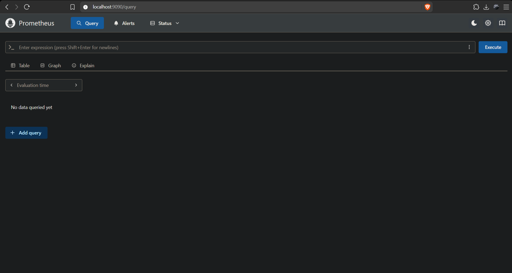
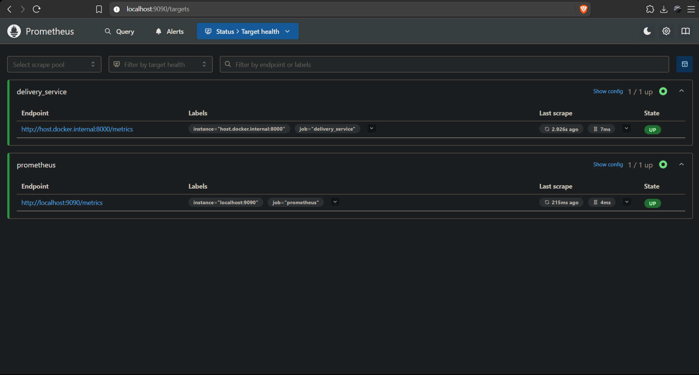
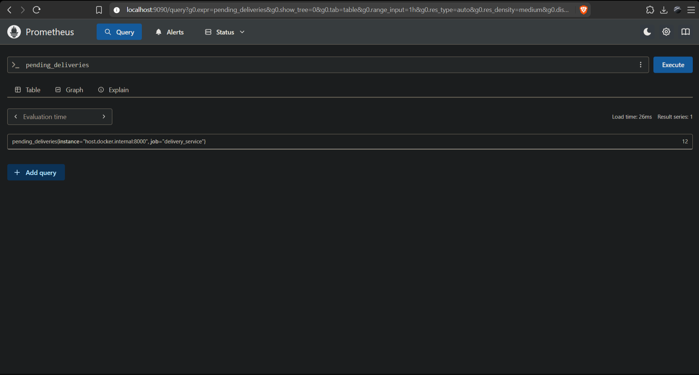
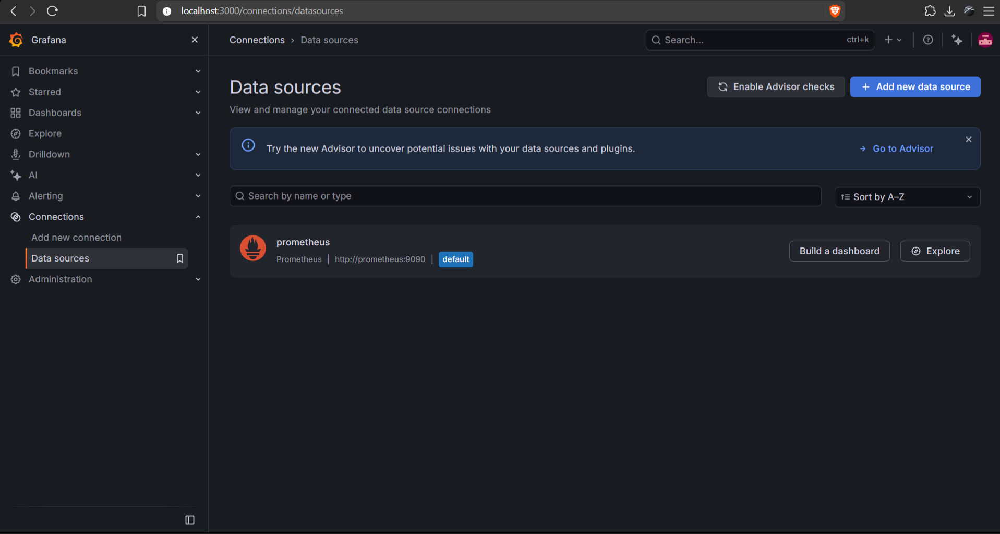
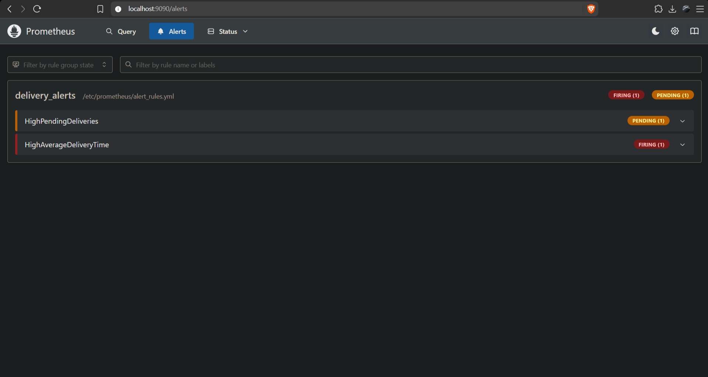
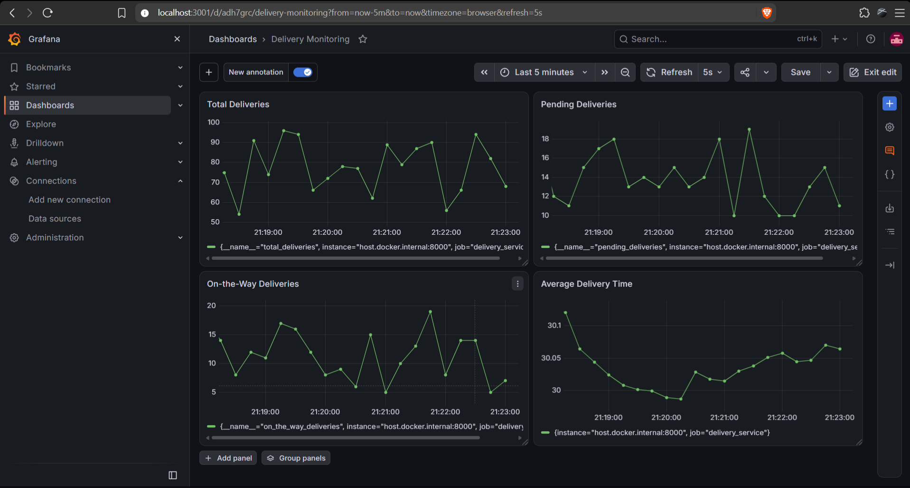
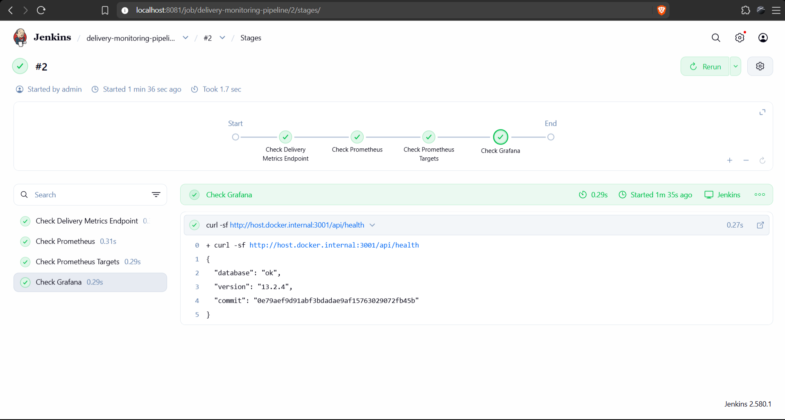
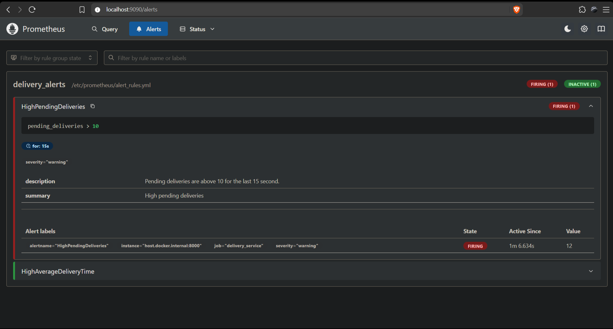
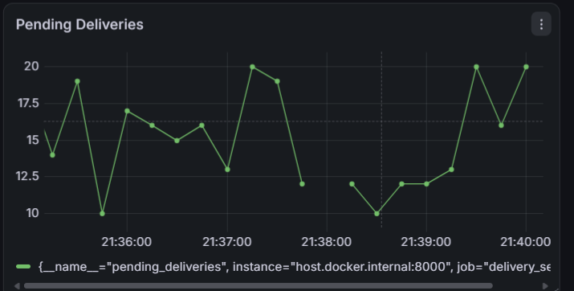

# Exercise 6: Real-Time Operations Monitoring and Alerting (Prometheus, Grafana, Jenkins)

## Problem Statement

As a DevOps engineer at a quick-commerce company, build a monitoring pipeline for a fast-paced delivery service. Use Python to simulate delivery metrics, Prometheus to scrape them, Grafana to visualize them on a dashboard, alert rules to detect problems quickly, and Jenkins to automate checks on the pipeline.

**Environment:** Windows, VS Code integrated terminal (Command Prompt), Docker Desktop, Python 3.10+

---

## Windows Adjustments

The original steps assume Linux. These changes were made so everything works on Windows with Docker Desktop:

- `python3` is replaced with `python`.
- `--network=host` and the IP `172.17.0.1` are Linux-only. Prometheus is published with `-p 9090:9090` and reaches the Python app on the host through `host.docker.internal`.
- Prometheus and Grafana run on a custom Docker network (`monitoring-net`), so Grafana can reach Prometheus by name (`http://prometheus:9090`).
- The whole project folder is mounted into the Prometheus container (instead of two single-file mounts), and the rules file is named `alert_rules.yml` everywhere.
- A `global` section (5s scrape/evaluation interval) is added to `prometheus.yml` so data and alerts show up quickly.
- The Jenkins pipeline is simplified: the `jenkins/jenkins:lts` image has no Docker CLI, so it runs health checks against the running stack instead of building containers.

---

## Solution (Brief)

1. Run a Python script that exposes simulated delivery metrics at `http://localhost:8000/metrics`.
2. Configure Prometheus (`prometheus.yml`) to scrape the metrics and load alert rules (`alert_rules.yml`).
3. Run Prometheus in Docker and verify the targets and alerts.
4. Run Grafana in Docker, add Prometheus as a data source, and build a delivery monitoring dashboard.
5. Run Jenkins in Docker and create a pipeline that checks the monitoring stack.
6. Simulate high pending deliveries and verify that the alert fires.

---

## Prerequisites Check

```cmd
docker --version
python --version
pip --version
```

```
Docker version 29.8.2, build 7fc2dff
Python 3.13.5
pip 25.1
```

---

## Files Created

Create a project folder and these files inside it:

```cmd
mkdir delivery_monitoring
cd delivery_monitoring
```

```
delivery_monitoring/
├── delivery_metrics.py   # Python script to simulate metrics
├── prometheus.yml        # Prometheus configuration
├── alert_rules.yml       # Alert rules
└── Jenkinsfile           # Jenkins pipeline script
```

**delivery_metrics.py**

```python
from prometheus_client import start_http_server, Summary, Gauge
import random
import time

# Metrics
total_deliveries = Gauge("total_deliveries", "Total number of deliveries")
pending_deliveries = Gauge("pending_deliveries", "Number of pending deliveries")
on_the_way_deliveries = Gauge("on_the_way_deliveries", "Number of deliveries on the way")
average_delivery_time = Summary("average_delivery_time", "Average delivery time in seconds")

# Simulate delivery statuses
def simulate_delivery():
    pending = random.randint(10, 20)  # Ensure values exceed the threshold
    on_the_way = random.randint(5, 20)
    delivered = random.randint(30, 70)
    avg_time = random.uniform(15, 45)

    total = pending + on_the_way + delivered

    print(f"[DEBUG] Total deliveries: {total}")
    print(f"[DEBUG] Pending deliveries: {pending}")
    print(f"[DEBUG] On-the-way deliveries: {on_the_way}")
    print(f"[DEBUG] Average delivery time: {avg_time:.2f} seconds")

    total_deliveries.set(total)
    pending_deliveries.set(pending)
    on_the_way_deliveries.set(on_the_way)
    average_delivery_time.observe(avg_time)

if __name__ == "__main__":
    print("[INFO] Starting the HTTP server on port 8000...")
    start_http_server(8000, addr="0.0.0.0")
    print("[INFO] HTTP server started. Simulating deliveries...")
    while True:
        simulate_delivery()
        print("[INFO] Sleeping for 1 seconds...")
        time.sleep(1)
```

**prometheus.yml**

```yaml
global:
  scrape_interval: 5s
  evaluation_interval: 5s

rule_files:
  - /etc/prometheus/alert_rules.yml

scrape_configs:
  - job_name: "prometheus"
    static_configs:
      - targets: ["localhost:9090"]

  - job_name: "delivery_service"
    static_configs:
      - targets: ["host.docker.internal:8000"]
```

**alert_rules.yml**

```yaml
groups:
  - name: delivery_alerts
    rules:
      - alert: HighPendingDeliveries
        expr: pending_deliveries > 10
        for: 15s
        labels:
          severity: warning
        annotations:
          summary: "High pending deliveries"
          description: "Pending deliveries are above 10 for the last 15 second."

      - alert: HighAverageDeliveryTime
        expr: (average_delivery_time_sum / average_delivery_time_count) > 30
        labels:
          severity: critical
        annotations:
          summary: "High average delivery time"
          description: "Average delivery time is above 30 seconds for the last 15 seconds."
```

---

## Commands Executed and Output

### Step 1: Run the Python metrics application

Install the dependency:

```cmd
pip install prometheus-client
```


Run the script (keep this terminal open; use a second terminal for the remaining commands):

```cmd
python delivery_metrics.py
```

```
[INFO] Starting the HTTP server on port 8000...
[INFO] HTTP server started. Simulating deliveries...
[DEBUG] Total deliveries: 81
[DEBUG] Pending deliveries: 11
[DEBUG] On-the-way deliveries: 10
[DEBUG] Average delivery time: 37.70 seconds
[INFO] Sleeping for 1 seconds...
```

Check the metrics endpoint from a new terminal (in the browser: http://localhost:8000/metrics):

```cmd
curl http://localhost:8000/metrics | findstr delivery
```

```
# HELP python_gc_objects_collected_total Objects collected during gc
# TYPE python_gc_objects_collected_total counter
python_gc_objects_collected_total{generation="0"} 333.0
python_gc_objects_collected_total{generation="1"} 5.0
python_gc_objects_collected_total{generation="2"} 0.0
# HELP python_gc_objects_uncollectable_total Uncollectable objects found during GC
# TYPE python_gc_objects_uncollectable_total counter
python_gc_objects_uncollectable_total{generation="0"} 0.0
python_gc_objects_uncollectable_total{generation="1"} 0.0
python_gc_objects_uncollectable_total{generation="2"} 0.0
# HELP python_gc_collections_total Number of times this generation was collected
# TYPE python_gc_collections_total counter
python_gc_collections_total{generation="0"} 13.0
python_gc_collections_total{generation="1"} 1.0
python_gc_collections_total{generation="2"} 0.0
# HELP python_info Python platform information
# TYPE python_info gauge
python_info{implementation="CPython",major="3",minor="13",patchlevel="5",version="3.13.5"} 1.0
# HELP total_deliveries Total number of deliveries
# TYPE total_deliveries gauge
total_deliveries 76.0
# HELP pending_deliveries Number of pending deliveries
# TYPE pending_deliveries gauge
pending_deliveries 17.0
# HELP on_the_way_deliveries Number of deliveries on the way
# TYPE on_the_way_deliveries gauge
on_the_way_deliveries 20.0
# HELP average_delivery_time Average delivery time in seconds
# TYPE average_delivery_time summary
average_delivery_time_count 27.0
average_delivery_time_sum 857.2178822787898
# HELP average_delivery_time_created Average delivery time in seconds
# TYPE average_delivery_time_created gauge
average_delivery_time_created 1.7919912492277243e+09
```

### Step 2: Validate the Prometheus configuration

```cmd
docker run --rm -v "%cd%:/etc/prometheus" --entrypoint promtool prom/prometheus check config /etc/prometheus/prometheus.yml
```

```
Checking /etc/prometheus/prometheus.yml
  SUCCESS: 1 rule files found
 SUCCESS: /etc/prometheus/prometheus.yml is valid prometheus config file syntax

Checking /etc/prometheus/alert_rules.yml
  SUCCESS: 2 rules found
```

### Step 3: Run Prometheus

Create a Docker network for the monitoring containers:

```cmd
docker network create monitoring-net
```

```
8baaab6da49894cadef41796d2759283f2e8105cf5c274e02e68d11caec43004
```

Start Prometheus:

```cmd
docker run -d --name prometheus --network monitoring-net -p 9090:9090 -v "%cd%:/etc/prometheus" prom/prometheus
```

```
478880d5dab47241845a86588561a6a86b9c3516df22c1fa0ec98133e50108f8
```

Verify that it is running and healthy:

```cmd
docker ps
```

```
CONTAINER ID   IMAGE             COMMAND                  CREATED          STATUS          PORTS                                         NAMES
478880d5dab4   prom/prometheus   "/bin/prometheus --c…"   14 seconds ago   Up 14 seconds   0.0.0.0:9090->9090/tcp, [::]:9090->9090/tcp   prometheus
```

```cmd
curl http://localhost:9090/-/healthy
```

```
curl http://localhost:9090/-/healthy
```

Open http://localhost:9090 in the browser:



Check **Status -> Targets** (both `prometheus` and `delivery_service` should be UP):



Run a query (for example `pending_deliveries`) in the Prometheus UI:



### Step 4: Run Grafana

```cmd
docker run -d --name grafana --network monitoring-net -p 3001:3000 grafana/grafana
```

```
aa4ce6cc29a60d5c7d8a81e1a5902536c2fab0eecd76530dc54cc1ec260af149
```

```cmd
docker ps
```

```
CONTAINER ID   IMAGE             COMMAND                  CREATED          STATUS          PORTS                                         NAMES
aa4ce6cc29a6   grafana/grafana   "/run.sh"                20 seconds ago   Up 20 seconds   0.0.0.0:3001->3000/tcp, [::]:3001->3000/tcp   grafana
478880d5dab4   prom/prometheus   "/bin/prometheus --c…"   6 minutes ago    Up 6 minutes    0.0.0.0:9090->9090/tcp, [::]:9090->9090/tcp   prometheus
```

Open http://localhost:3000 and log in with `admin` / `admin` (skip the password change).

**Add Prometheus as a data source:** Connections -> Data sources -> Add data source -> Prometheus.
- URL: `http://prometheus:9090`
- Leave the other fields as default and click **Save & test**.



**Verify alerts in Prometheus** (http://localhost:9090/alerts):



### Step 5: Create the Grafana dashboard

Create a new dashboard (Dashboards -> New -> New dashboard -> Add visualization) with these panels:

| Panel | Query |
|---|---|
| Total Deliveries | `total_deliveries` |
| Pending Deliveries | `pending_deliveries` |
| On-the-Way Deliveries | `on_the_way_deliveries` |
| Average Delivery Time | `average_delivery_time_sum / average_delivery_time_count` |

Save the dashboard as **Delivery Monitoring** and set the time range to the last 5 minutes with 5s auto-refresh.



### Step 6: Run Jenkins and create the pipeline

Start Jenkins:

```cmd
docker run -d -p 8081:8080 -p 50000:50000 --name jenkins -v jenkins_home:/var/jenkins_home jenkins/jenkins:lts
```

```
f52a6923a28814cc81cc551e37761d6b745c19d4c8d6d5886c8818323997f085
```

```cmd
docker ps
```

```
CONTAINER ID   IMAGE                 COMMAND                  CREATED          STATUS          PORTS                                                                                          NAMES
f52a6923a288   jenkins/jenkins:lts   "/usr/bin/tini -- /u…"   20 seconds ago   Up 20 seconds   0.0.0.0:50000->50000/tcp, [::]:50000->50000/tcp, 0.0.0.0:8081->8080/tcp, [::]:8081->8080/tcp   jenkins
aa4ce6cc29a6   grafana/grafana       "/run.sh"                23 minutes ago   Up 23 minutes   0.0.0.0:3001->3000/tcp, [::]:3001->3000/tcp                                                    grafana
478880d5dab4   prom/prometheus       "/bin/prometheus --c…"   29 minutes ago   Up 29 minutes   0.0.0.0:9090->9090/tcp, [::]:9090->9090/tcp                                                    prometheus
```

Get the initial admin password (wait about a minute for Jenkins to start):

```cmd
docker exec jenkins cat /var/jenkins_home/secrets/initialAdminPassword
```

```
Password :)
```

Open http://localhost:8081, enter the password, install the suggested plugins, and create the admin user.

**Jenkinsfile**

```groovy
pipeline {
    agent any
    stages {
        stage('Check Delivery Metrics Endpoint') {
            steps {
                sh '''
                curl -sf http://host.docker.internal:8000/metrics | grep -E "total_deliveries|pending_deliveries|on_the_way_deliveries"
                '''
            }
        }
        stage('Check Prometheus') {
            steps {
                sh 'curl -sf http://host.docker.internal:9090/-/healthy'
            }
        }
        stage('Check Prometheus Targets') {
            steps {
                sh '''
                curl -sf http://host.docker.internal:9090/api/v1/targets | grep -o '"health":"[a-z]*"'
                '''
            }
        }
        stage('Check Grafana') {
            steps {
                sh 'curl -sf http://host.docker.internal:3000/api/health'
            }
        }
    }
}
```

In Jenkins: **New Item -> name it `delivery-monitoring-pipeline` -> Pipeline -> OK -> Pipeline script**, paste the Jenkinsfile above, **Save**, then click **Build Now**.


Open the build's **Console Output**:

```
Started by user admin

[Pipeline] Start of Pipeline
[Pipeline] node
Running on Jenkins
 in /var/jenkins_home/workspace/delivery-monitoring-pipeline
[Pipeline] {
[Pipeline] stage
[Pipeline] { (Check Delivery Metrics Endpoint)
[Pipeline] sh
+ curl -sf http://host.docker.internal:8000/metrics
+ grep -E total_deliveries|pending_deliveries|on_the_way_deliveries
# HELP total_deliveries Total number of deliveries
# TYPE total_deliveries gauge
total_deliveries 52.0
# HELP pending_deliveries Number of pending deliveries
# TYPE pending_deliveries gauge
pending_deliveries 12.0
# HELP on_the_way_deliveries Number of deliveries on the way
# TYPE on_the_way_deliveries gauge
on_the_way_deliveries 10.0
[Pipeline] }
[Pipeline] // stage
[Pipeline] stage
[Pipeline] { (Check Prometheus)
[Pipeline] sh
+ curl -sf http://host.docker.internal:9090/-/healthy
Prometheus Server is Healthy.
[Pipeline] }
[Pipeline] // stage
[Pipeline] stage
[Pipeline] { (Check Prometheus Targets)
[Pipeline] sh
+ curl -sf http://host.docker.internal:9090/api/v1/targets
+ grep -o "health":"[a-z]*"
"health":"up"
"health":"up"
[Pipeline] }
[Pipeline] // stage
[Pipeline] stage
[Pipeline] { (Check Grafana)
[Pipeline] sh
+ curl -sf http://host.docker.internal:3001/api/health
{
  "database": "ok",
  "version": "13.2.4",
  "commit": "0e79aef9d91abf3bdadae9af15763029072fb45b"
}
[Pipeline] }
[Pipeline] // stage
[Pipeline] }
[Pipeline] // node
[Pipeline] End of Pipeline
Finished: SUCCESS

```



### Step 7: Simulate alerts

Stop the Python script (Ctrl+C in its terminal), then edit `delivery_metrics.py` and increase the pending deliveries range:

```python
pending = random.randint(50, 100)  # Increase range to exceed alert threshold
```

Restart the script (in its own terminal) and restart Prometheus:

```cmd
python delivery_metrics.py
```

```cmd
docker restart prometheus
```

```
prometheus
```

Wait about 20 seconds, then check http://localhost:9090/alerts for `HighPendingDeliveries` in the **FIRING** state:



Pending deliveries on the Grafana dashboard after the change:



### Cleanup (optional)

```cmd
docker rm -f prometheus grafana jenkins
docker network rm monitoring-net
```

```
prometheus
grafana
jenkins
monitoring-net
```

---

## Result

The Python app exposed delivery metrics, Prometheus scraped them and evaluated the alert rules, Grafana visualized them on a Delivery Monitoring dashboard, Jenkins ran a pipeline that checked the whole stack, and increasing the pending deliveries triggered the `HighPendingDeliveries` alert.

---

## Notes

- **Metric types:** a *Gauge* is a value that can go up or down (`total_deliveries`, `pending_deliveries`, `on_the_way_deliveries`). A *Summary* tracks observations and exposes `_sum` and `_count`, so the average is `average_delivery_time_sum / average_delivery_time_count`.
- **/metrics endpoint:** created automatically by `start_http_server` from the `prometheus_client` library.
- **host.docker.internal:** lets a container reach services running on the Windows host (the Python app on port 8000).